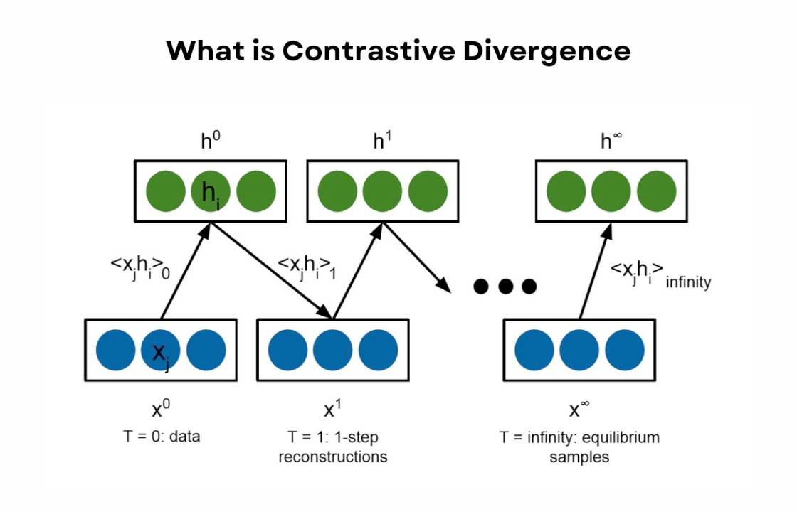
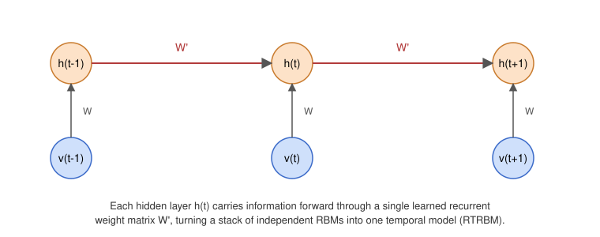

# RBMs and DBNs

Restricted Boltzmann Machines (RBMs) + Deep Belief Networks (DBNs) - An RBM are simple 2-layer generative models, that are trained here using an unsupervised learning algorithm called contrastive divergence, during which, the optimizers goal is to be able to reconstruct samples that fall within the distribution of the input samples, X, by sampling the output of the model. In doing so, the model develops an in-depth understanding of the internal structure of the data.\
RBMs can also be stacked together, to create a deep architecture called a Deep Belief Network (Hinton et al., 2006). Because of the nature of RBMs, the training process of DBNs can be done in a layer-wise fashion, making it less resource hungry than typical backpropagation-based model training techniques. SIT-FUSE allows for DBNs to be used as well as simple RBMs

<figure><figcaption>
A diagram depicting contrastive divergence
</figcaption></figure>

<figure><figcaption>
A depiction of stacked RBMs, creating  DBNs
</figcaption></figure>

## RTRBMs and RTDBNs

A Recurrent Temporal RBM (RTRBM) extends an RBM by adding a recurrent connection between the hidden layer at each timestep and the next, so the hidden state at time t depends on the hidden state at time t-1 and the visible input at time t. A standard RBM treats every timestep as an independent sample and cannot represent how a sequence changes over time; the recurrent connection gives an RTRBM that ability, letting it pick up on temporal patterns like the phase of a movement cycle. RTRBMs can be stacked into a Recurrent Temporal DBN (RTDBN, Sutskever et al., 2008), trained layer-wise like standard DBNs.

SIT-FUSE extends Learnergy with Bernoulli, fixed-variance Gaussian, and learned-variance Gaussian RTRBM variants, along with an RTDBN wrapper built around the learned-variance Gaussian variant, so temporal data such as biomechanical movement sequences can be modeled with the same self-supervised, layer-wise training used elsewhere in SIT-FUSE.

In an RTDBN, the sequence of hidden activations produced by one RTRBM layer is the input sequence for the next layer. Layers are pre-trained one at a time (greedy layer-wise training): each layer is trained with contrastive divergence at every timestep, carrying its hidden state forward through the window, while the layers below it are held fixed. This is not end-to-end backpropagation through time. The learned-variance Gaussian RTRBM models real-valued inputs by learning a separate variance (sigma) for each input feature. Because the variance is only meaningful when the input features are on a comparable scale, SIT-FUSE standardizes RTDBN inputs to zero mean and unit variance (scaler fit on the training episodes only), and keeps sigma fixed for the first `warmup_epochs` epochs of each layer's training before letting it be learned. A deep clustering head, trained with the same IIC objective used for DBNs, can then be placed on top of the frozen encoder.

Inputs are windows of consecutive timesteps cut from each recorded sequence, so one RTDBN embedding describes a short window of a movement rather than a single frame. To train and run an RTDBN, see the [Training Command](../../user-guide/model-training/training-command-examples.md) and [RTDBN-Specific Config Options](../../user-guide/code-configuration/code-configuration/config-options/rtdbn-specific-config-options.md) pages. For an application of RTDBNs to human movement data, see [Biomechanical Movement Analysis](../../sitfuse-use-cases/biomechanical-movement-analysis/README.md).

<figure><figcaption>
A depiction of the recurrent connection that turns an RBM into an RTRBM
</figcaption></figure>

References:

1. Hinton, G. E. (2012). A Practical Guide to Training Restricted Boltzmann Machines.. In G. Montavon, G. B. Orr & K.-R. Müller (ed.), _Neural Networks: Tricks of the Trade (2nd ed.)_ , Vol. 7700 (pp. 599-619) . Springer . ISBN: 978-3-642-35288-1.
2. Carreira-Perpinan, M. A. & Hinton, G. E. (2005). On Contrastive Divergence Learning . In Intelligence, A. & Statistics, 2005, B. (ed.), .
3. Renjie Liao, Simon Kornblith, Mengye Ren, David J. Fleet, Geoffrey Hinton: “Gaussian-Bernoulli RBMs Without Tears”, 2022; [arXiv:2210.10318](http://arxiv.org/abs/2210.10318).
4. Sutskever, I., Hinton, G. E. & Taylor, G. W. (2008). The Recurrent Temporal Restricted Boltzmann Machine. In _Advances in Neural Information Processing Systems_, Vol. 21.

