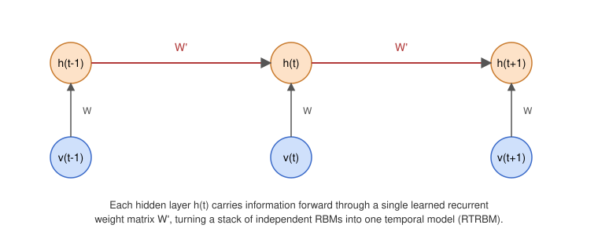

# Biomechanical Movement Analysis

### **Project Overview**

SIT-FUSE's self-supervised representation learning is not limited to satellite imagery. This use case applies a sequence-aware extension of SIT-FUSE, built around the Recurrent Temporal Restricted Boltzmann Machine (RTRBM) and the Recurrent Temporal Deep Belief Network (RTDBN), to biomechanical movement data: continuous, high-dimensional recordings of joint positions, velocities, and muscle activations. The goal is the same as for SIT-FUSE's remote sensing data. Without any labels, can a model learn a representation that organizes the data in a meaningful way, and can that representation be clustered and inspected with the rest of the SIT-FUSE toolkit?

We evaluated the approach on simulated musculoskeletal reaching and on two real human gait datasets. The method and its evaluation are described in Sharif and LaHaye (2026).

#### **Why Biomechanical Movement?**

<figure><figcaption>
A depiction of the recurrent connection that turns an RBM into an RTRBM
</figcaption></figure>

Biomechanical recordings are inherently sequential. Information about a movement is spread across time, so treating each observation as an independent sample reduces a movement to a set of disconnected snapshots. The usual fix is supervision, training a classifier on hand-labeled recordings (Al-Timemy et al., 2022), but labeling is costly, and models trained on labeled recordings often degrade when the sensor placement, device, or subject population changes (Chakma et al., 2023; Dhekane & Ploetz, 2024). Unsupervised methods that find temporal structure directly in raw data reduce the labeling effort.

Standard RBMs and DBNs (Hinton et al., 2006), which SIT-FUSE already uses, process every input frame by itself. The RTRBM (Sutskever et al., 2008) adds a recurrent connection from the hidden units at one timestep to the next, so that earlier frames inform the current one. Earlier temporal RBMs were applied to human movement mainly to generate, predict, or fill in motion-capture sequences (Taylor et al., 2011; Sukhbaatar et al., 2011). Here, the RTRBM is used instead as an encoder that maps a window of movement to a fixed-length embedding. See [RBMs and DBNs](../../readme/self-supervised-representation-learning/rbms-and-dbns.md) for background on the model.

#### **Our Data Flow**

1. **Windowing.** Each recording is cut into windows of consecutive timesteps, and windows never span two recordings. Training uses a scaler fit on the training recordings only (zero mean and unit variance per channel).
2. **RTRBM encoder.** Real-valued signals are modeled with a Gaussian-visible RTRBM with a learned variance for each input channel (Cho et al., 2011). It is trained with contrastive divergence at each timestep, using a two-phase schedule in which the variance is held fixed for the first 15 epochs and then learned for 15 more.
3. **RTDBN embedding.** The RTRBM layers are stacked into an RTDBN (greedy layer-wise training). The hidden states across the window are averaged over time into a single 64-dimensional embedding per window. The experiments here use a single RTRBM layer.
4. **Clustering and analysis.** The embeddings are clustered with k-means (k = 10) and evaluated as described in [Simulated Reaching](simulated-reaching.md) and [Real Gait Data](real-gait-data.md). The encoder is also available inside SIT-FUSE with `encoder_type: rtdbn` (see [SIT-FUSE Integration](sit-fuse-integration.md)).

#### **Statistical Methods**

1. **Seeds and splits.** Results are reported over ten seeds, where the seed controls the data split, weight initialization, and k-means initialization. Reaching data is split by episode (70/15/15), and gait data is split by subject, so test subjects are never seen in training.
2. **Reporting.** We report the mean ± standard deviation across seeds. Models are compared with paired differences across seeds, using 95% bootstrap confidence intervals, and p-values for the gait comparisons are corrected for multiple comparisons with the Holm procedure.
3. **Reconstruction.** Held-out reconstruction quality is measured with the mean squared error (MSE) and the per-channel R², where R² = 1 − MSE / variance of the channel. The median over channels is reported.
4. **Clustering quality.** The **silhouette score** measures how much closer each point is to its own cluster than to other clusters, and **normalized entropy** measures how evenly points are spread across clusters (1 is uniform, 0 is a complete collapse). Normalized mutual information (NMI) measures agreement between the clusters and ten equal bins of the position of the window within its episode.
5. **Probes.** A ridge regression or classifier is fit on frozen embeddings and scored on held-out data. Reaching targets are scored with R². Gait walking speed is scored with accuracy, where chance is 0.333 for the three speeds, using logistic regression (linear) and random forest probes.


[simulated-reaching.md](simulated-reaching.md)



[real-gait-data.md](real-gait-data.md)



[sit-fuse-integration.md](sit-fuse-integration.md)



[conclusions.md](conclusions.md)



[bibliography.md](bibliography.md)

