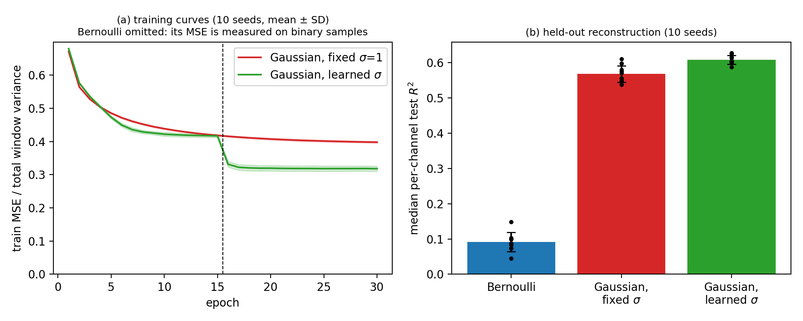
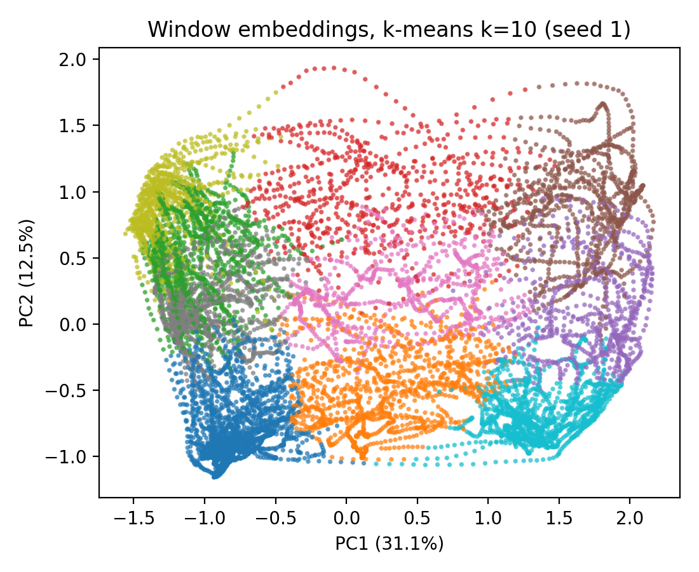
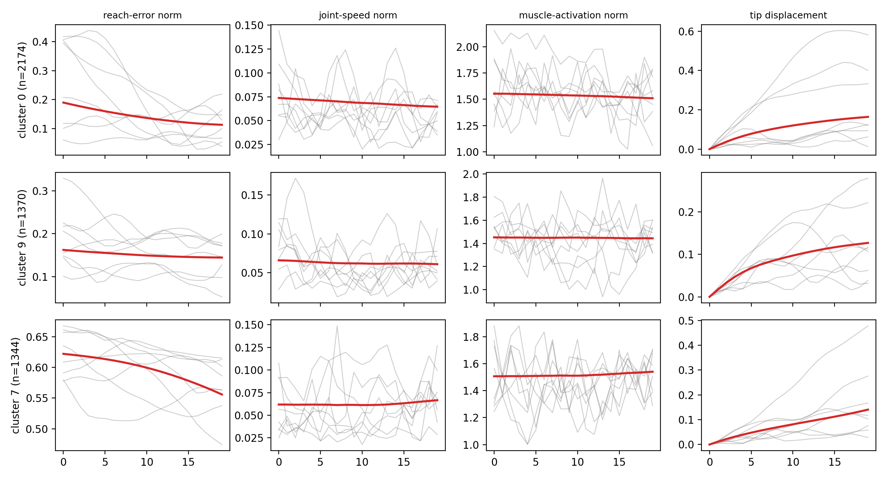

# Simulated Reaching

### **Simulated Reaching**

#### **Data Acquisition**

1. We generated reaching data from the `myoArmReachFixed-v0` environment in MyoSuite (Caggiano et al., 2022), which uses the MuJoCo (Multi-Joint dynamics with Contact) physics engine (Todorov et al., 2012) to simulate a physiological upper-limb model reaching toward a fixed target.
2. We ran 100 episodes of 151 steps each. Each observation has 80 dimensions: joint positions (20), joint velocities (20), reach-site position (3), reach error, the displacement between the target and the reach site (3), and muscle activations (34).
3. Actions came from a momentum-biased random policy. At each timestep, an action is drawn around a slowly adapting drift vector that is nudged toward actions that reduced the distance to the target.

#### **Data Processing**

1. Episodes were split into 70 training, 15 validation, and 15 test episodes, so windows from one episode never cross a split boundary.
2. A scaler was fit on the training episodes and applied to the validation and test data.
3. A sliding window of 20 timesteps (stride 1) was cut inside each episode. The RTRBM has 64 hidden units, so each window becomes a 64-dimensional embedding, and the embeddings are clustered with k-means (k = 10).

#### **Data Analysis**

1. **Choice of visible units.** We compared Bernoulli, fixed-variance Gaussian, and learned-variance Gaussian RTRBMs on held-out per-channel R².
2. **Clustering.** We measured silhouette, normalized entropy, and NMI against the position of the window within its episode, and fit a ridge probe to recover that position from the embedding. We then inspected the kinematics of the largest clusters.
3. **Generalization.** We applied the trained encoder and k-means centroids to the held-out test episodes.
4. **Ablations.** We varied the window length (10 to 40 timesteps) and the number of hidden units (32, 64, 128), and swept k from 2 to 20.

#### **Data Results**

1. **Learned variance reconstructs best.** The median held-out R² was 0.09 ± 0.03 for the Bernoulli model, 0.57 ± 0.02 for the fixed-variance Gaussian model, and 0.61 ± 0.01 for the learned-variance model. The learned-variance model also lowered held-out MSE by 189 relative to the fixed-variance model (539 ± 27 vs 728 ± 21). Its joint kinematics reconstruct well (median R² of 0.86 for positions and 0.76 for velocities) and muscle activations moderately (0.56).

<figure><figcaption>
(a) Training error relative to window variance for the fixed-variance and learned-variance Gaussian RTRBMs; the dashed line marks the epoch when the variance is unfrozen. (b) Median per-channel held-out R² for all three variants.
</figcaption></figure>

2. **Clusters are balanced and carry movement structure.** The 11,220 training and validation windows spread over all 10 clusters with a normalized entropy of 0.978 ± 0.007. The silhouette score was 0.154 ± 0.013, which indicates overlapping rather than sharply separated clusters, as expected for windows sampled along continuous trajectories. Cluster agreement with the position of the window within its episode was moderate (NMI 0.265 ± 0.013), and a linear probe recovered that position from the embedding with R² = 0.79 ± 0.04.

<figure><figcaption>
PCA of the 64-dimensional embeddings for 11,220 windows (one seed), colored by k-means cluster.
</figcaption></figure>

3. **Clusters can be read in terms of distance to the target and closing rate.** For one seed, the largest cluster is near the target (mean reach-error norm 0.143 m) and still closing the gap (falling by 0.077 m within the window). The second is also near the target (0.151 m) but nearly static (falling by 0.018 m). The third is far from the target (0.597 m) and closing slowly (0.066 m). Across all 10 clusters, the mean reach-error norm falls into three bands (about 0.14 to 0.23 m, 0.43 to 0.50 m, and 0.58 to 0.65 m), with the closing rate varying within each band. These readings describe a single seed, and cluster identities and sizes differ across seeds.

<figure><figcaption>
Eight randomly drawn example windows from each of the three largest clusters (rows) across four observation-derived channels (columns). Thin lines are individual windows and the bold line is the mean.
</figcaption></figure>

4. **Clusters transfer to unseen episodes.** On the 15 held-out test episodes (1,980 windows), all 10 clusters stayed populated, normalized entropy was 0.952 ± 0.031, and silhouette was 0.170 ± 0.018, compared with 0.154 ± 0.013 on the training and validation episodes. Held-out reconstruction error was as low on the test episodes (539 ± 27) as on the validation episodes (547 ± 29), which is consistent with no overfitting to the training episodes.
5. **Ablations.** Once reconstruction error is divided by window size, window length has almost no effect (median R² of 0.60 to 0.61 for every length). The number of hidden units matters more: median R² rose from 0.549 at 32 units to 0.610 at 64 and 0.678 at 128, while silhouette moved the other way (0.212, 0.153, 0.141). Sweeping k from 2 to 20 showed silhouette declining overall from 0.247 to 0.142 with no sharp elbow, so k = 10 was kept as a fixed clustering resolution.

#### **Study Implementation**

All reaching results are over ten seeds with the data, training schedule, and splits described on the [overview](README.md) page. Learning rates were chosen by grid search on validation reconstruction error only.
